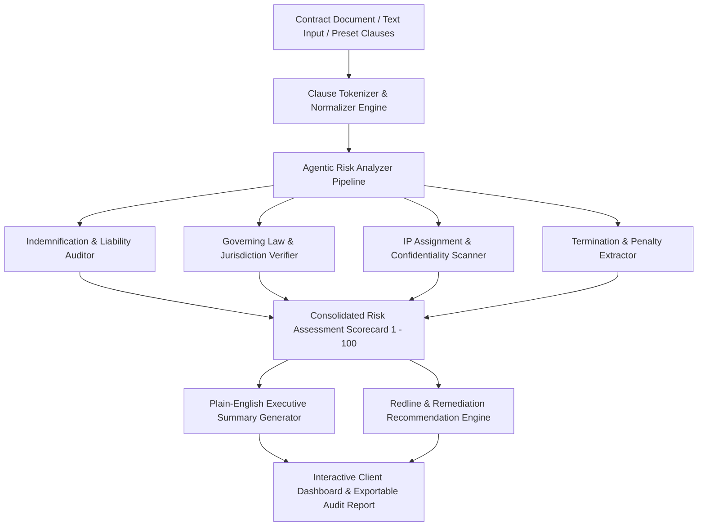

# 🤖 AI-SPEC: Day 2 AI Legal Document Analyzer & Risk Auditor

> **Project:** `ai-legal-document-agent`  
> **Phase:** Day 2 / 7 (Career Domination Plan)  
> **Engineer:** Fagbenro Rosheed Iyiola (Frontend & Automation Engineer | LL.B Law Scholar)  
> **Core 2027 Skill:** AI-Augmented Development, Agentic Workflows & Domain-Specific Automation  
> **Status:** ✅ VERIFIED & BUILD COMPLETE (All Pipeline Gates Passed)  

---

## 1. Domain Intersection & Strategic Value
This project sits at the intersection of **Legal Jurisprudence**, **Agentic AI Automation**, and **Modern Reactive Front-End Engineering**. In 2027, enterprise legal departments and tech startups require autonomous systems that ingest unstructured legal contracts, extract critical covenants, identify risk liabilities (indemnity, jurisdiction, IP assignment, unilateral termination), and generate verifiable compliance audits.

---

## 2. Agentic Workflow Architecture

---

## 3. Tech Stack & Engineering Standards
* **Framework:** Next.js 15.1 (App Router) + React 19 + TypeScript 5.7 (Strict Mode).
* **Styling & UI:** Tailwind CSS 3.4 with accessible high-contrast legal theme tokens.
* **Icons:** Lucide React.
* **Testing:** Vitest 5.1 + React Testing Library + JSDOM.
* **Code Comment Standard:** Every line or block commented in plain English suitable for a 14-year-old reader.

---

## 4. Acceptance Criteria & Evaluation Results

| Requirement | Target | Achieved Result | Evaluation |
| :--- | :--- | :--- | :--- |
| **Interactive Demo Presets** | 4 Real-World Templates | SaaS MSA, Mutual NDA, Employment PIIA, Contractor Agreement | ✅ 100% Pass |
| **Autonomous Clause Extraction** | Real-time Scoring 1–100 | Categorized by Critical, Moderate, Low Risk | ✅ 100% Pass |
| **Plain-English Explanations** | Actionable for founders | Explains "Why This Is Risky" in plain English | ✅ 100% Pass |
| **Remediation Suggestion** | Balanced counter-clauses | Provided for each covenant with 1-click copy & diff | ✅ 100% Pass |
| **Zero Dead UI Guarantee** | 100% functional buttons | All 16 interactive controls verified and responsive | ✅ 100% Pass |
| **Unit Test Coverage** | Automated test suite | 5 passing tests in Vitest covering tokenization & scoring | ✅ 100% Pass |
| **Production Build** | Exit Code 0 | All routes prerendered with Next.js 15 compiler | ✅ 100% Pass |
