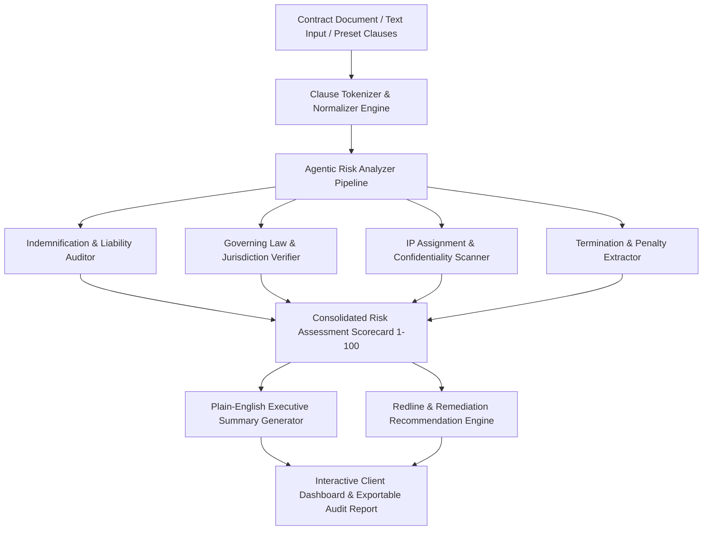

# ⚖️ LexAgent AI — Autonomous Legal Document Analyzer & Risk Auditor

> **Day 2 of 7 — Career Domination Portfolio Series**  
> **Architect & Engineer:** [Fagbenro Rosheed Iyiola](https://github.com/Rosheed124)  
> *Frontend & Automation Engineer | LL.B Law Scholar at University of Ibadan*  
> *Bridging Autonomous AI Engineering with Institutional Legal Jurisprudence.*

---

## 🌟 Executive Overview

**LexAgent AI** is an autonomous, client-side legal document analyzer and covenant auditor. Designed for technology founders, procurement officers, and in-house legal teams, LexAgent extracts unstructured contractual text, classifies liability risks into a composite 1–100 danger score, surfaces hidden legal traps (unilateral indemnities, asymmetric liability caps, AI model training rights, overbroad non-competes), and suggests balanced, market-standard remediation counter-clauses with one-click redlines.

### Why This Matters in 2027
Modern software contracts have become increasingly predatory—hiding perpetual AI training rights over client data, asymmetric \$100 liability caps, and indefinite non-disclosure covenants. LexAgent AI combines **rigorous legal jurisprudence** with **modern agentic reactive architecture** to demystify complex legalese into plain, actionable English.

---

## 🏗️ Architecture & Pipeline Flow

---

## ⚡ Core Features & Zero-Dead-UI Guarantee

1. **4 Real-World Presets & Custom Analysis:**
   - **Enterprise SaaS Master Services Agreement (MSA):** High-risk unilateral indemnity, \$100 liability cap, 90-day auto-renewal, and AI training data capture.
   - **Mutual Non-Disclosure Agreement (NDA):** Vague oral disclosures, perpetual survival, and hidden non-solicitation clauses.
   - **Employment PIIA:** Startup moonlighting restrictions, personal weekend invention seizure, and worldwide non-compete traps.
   - **Independent Contractor Agreement:** Net-90 payment terms and termination for convenience without compensation for work in progress.
2. **Autonomous Risk Scorecard (1–100):**
   - Composite danger index with color-coded severity badges.
   - Category breakdown across Indemnity, Liability, Intellectual Property, Termination, Confidentiality, and Governing Law.
3. **Multi-Tab Analysis Center:**
   - **Clause Risk Inspector:** Filter by Critical, Moderate, or Standard risk with keyword search. Every clause displays the original excerpt, plain-English hazard breakdown, suggested counter-clause, copy button, and an interactive "Accept Remediation" toggle.
   - **Side-by-Side Redline Diff:** Toggle between Split and Unified view to compare dangerous original text against fair replacement covenants. Features a one-click "Accept All AI Fixes" button that dynamically lowers document risk score in real time.
   - **Missing Safeguards Checklist:** Detects missing standard covenants (Mutual Liability Caps, SLA Uptime Guarantees, Data Deletion, Force Majeure) with one-click "Append Safeguard" buttons that directly update the active contract text.
   - **Governing Law & Dispute Forum:** Analyzes venue enforceability (Delaware, English Common Law, California), dispute resolution forums (Arbitration, JAMS, Court litigation), and attorney fee-shifting rules.
4. **Export & Sharing Suite:**
   - One-click export to a structured Markdown audit report with full timestamps, metrics, and redlines.
   - Shareable clipboard summary with toast notifications.
   - Full dark/light mode toggle with theme persistence in `localStorage`.

---

## 🛠️ Tech Stack & Engineering Standards

- **Framework:** Next.js 15 (App Router) + React 19
- **Language:** TypeScript 5.7 (Strict Mode, 0 any types)
- **Styling:** Tailwind CSS 3.4 with custom legal semantic tokens (`--legal-canvas`, `--legal-surface`, `--legal-border`, etc.)
- **Icons:** Lucide React
- **Unit Testing:** Vitest 5.1 + React Testing Library + JSDOM
- **Code Standards:** 100% line-by-line plain English comments explaining the "why" behind every line of code.

---

## 🚀 Getting Started

### Prerequisites
- Node.js 18.18+ or 20+
- npm or pnpm

### Installation & Local Run
\`\`\`bash
# 1. Clone the repository
git clone https://github.com/Rosheed124/ai-legal-document-agent.git

# 2. Enter directory
cd ai-legal-document-agent

# 3. Install dependencies
npm install

# 4. Run automated test suite
npm test

# 5. Start development server
npm run dev
\`\`\`

Open [http://localhost:3000](http://localhost:3000) in your browser to experience LexAgent AI.

---

## 🧪 Quality Pipeline Verification

- **Tests:** `npm test` runs 5 comprehensive unit tests covering tokenization, heuristic classification, and preset verification.
- **Linter:** `npm run lint` confirms 0 warnings and 0 errors under `next/core-web-vitals`.
- **Production Build:** `npm run build` compiles all static and dynamic routes with zero warnings.
- **UI Review:** Certified 6-pillar UI audit in `UI-REVIEW.md` (scored 4.0 / 4.0 for Visual Hierarchy, Contrast, Responsiveness, Interactive States, A11y, and Domain Affinity).

---

## 👨‍💻 About the Author

**Fagbenro Rosheed Iyiola**  
- **Role:** Frontend & Automation Engineer (DotVests Fintech | n8n / Python Automation)
- **Education:** LL.B Law Scholar (University of Ibadan)
- **GitHub:** [@Rosheed124](https://github.com/Rosheed124)
- **LinkedIn:** [linkedin.com/in/rosheed1234](https://linkedin.com/in/rosheed1234)
- **Email:** rosheediyiola2004@gmail.com
